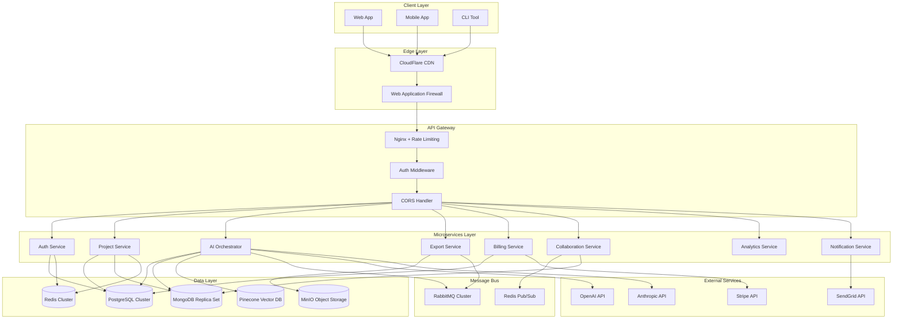

# WorldBest Platform Comprehensive Enhancement Design

## Overview

This enhancement design provides a strategic roadmap for transforming the WorldBest platform from its current development state into a production-ready, scalable commercial platform for writers. The design addresses performance optimization, feature completion, security hardening, operational excellence, and user experience improvements across all system components.

The enhancement strategy focuses on completing missing microservices, optimizing existing implementations, introducing advanced AI capabilities, implementing real-time collaboration features, and establishing enterprise-grade operational practices.

## Technology Stack Enhancement

### Current State Analysis

| Component | Current Status | Enhancement Priority |
|-----------|---------------|---------------------|
| Frontend (Next.js) | Partially implemented | High - Complete features |
| Authentication Service | Functional basic implementation | Medium - Security hardening |
| AI Orchestrator | Stub implementation | High - Core functionality |
| Project Service | Minimal implementation | High - Complete CRUD operations |
| Database Layer | Schema defined | Medium - Optimization |
| Infrastructure | Docker setup complete | Medium - Kubernetes optimization |

### Enhanced Technology Stack

| Layer | Technology | Enhancement Focus |
|-------|------------|------------------|
| **Frontend** | Next.js 14, React 18, TypeScript | Performance, real-time features, mobile responsiveness |
| **Backend Services** | Node.js, Fastify, Express | Microservices completion, performance optimization |
| **Databases** | PostgreSQL 16, MongoDB 7, Redis 7 | Query optimization, indexing strategies, caching |
| **AI/ML** | OpenAI GPT-4, Anthropic Claude, Pinecone | Advanced prompt engineering, embeddings optimization |
| **Infrastructure** | Kubernetes, Docker, Nginx | Production-grade deployment, auto-scaling |
| **Monitoring** | Prometheus, Grafana, ELK Stack | Comprehensive observability |

## Architecture Enhancement

### Enhanced System Architecture

### Microservices Enhancement Strategy

#### 1. Authentication Service Enhancement

**Current State**: Basic JWT authentication with rate limiting
**Enhanced Features**:
- Multi-factor authentication (TOTP, SMS, email)
- Social login integration (Google, GitHub, Discord)
- Role-based access control with fine-grained permissions
- Session management with refresh token rotation
- Audit logging for security events
- Password strength enforcement
- Account lockout protection
- SSO integration for enterprise customers

**Security Hardening**:
- Implement OAuth 2.0 + PKCE for mobile clients
- Add biometric authentication support
- Implement device fingerprinting
- Add suspicious activity detection
- Implement CSRF protection
- Add request signing for API security

#### 2. Project Service Enhancement

**Current State**: Minimal implementation with basic CRUD
**Enhanced Features**:
- Comprehensive project management with hierarchical structure
- Version control for all project artifacts
- Collaborative editing with conflict resolution
- Template system for common project types
- Advanced search across all project content
- Project analytics and progress tracking
- Backup and restore functionality
- Import/export from popular writing tools

**Data Model Enhancement**:
- Optimized database schema with proper indexing
- Document versioning with delta compression
- Real-time synchronization capabilities
- Advanced caching strategies
- Full-text search implementation
- Relationship mapping between entities

#### 3. AI Orchestrator Service Enhancement

**Current State**: Stub implementation with basic generation
**Enhanced Features**:
- Three specialized AI personas (Muse, Editor, Coach)
- Context-aware prompt engineering
- Multi-model routing and fallback strategies
- Token usage optimization and caching
- Batch processing for efficiency
- Custom model fine-tuning capabilities
- AI-powered content analysis and suggestions
- Intelligent content safety and moderation

**AI Persona Implementation**:

| Persona | Purpose | Model Strategy | Context Requirements |
|---------|---------|---------------|---------------------|
| **Muse** | Creative inspiration and brainstorming | GPT-4 Turbo, Claude-3 | Story bible, character profiles, plot outlines |
| **Editor** | Prose refinement and structural feedback | GPT-4, fine-tuned models | Draft text, style guides, target audience |
| **Coach** | Writing guidance and motivation | GPT-3.5 Turbo, specialized prompts | Progress data, goals, writing history |

#### 4. Collaboration Service (New)

**Purpose**: Real-time collaborative editing and communication
**Core Features**:
- Operational Transform for concurrent editing
- Real-time cursor tracking and user presence
- Comment system with threaded discussions
- Suggestion mode for editorial feedback
- Live chat integration
- Notification system for collaboration events
- Conflict resolution with manual merge capabilities
- Permission-based access control

**WebSocket Implementation**:
- Socket.IO for real-time communication
- Redis for horizontal scaling
- Message persistence for offline users
- Rate limiting for abuse prevention
- Authentication integration
- Room-based isolation for projects

#### 5. Export Service Enhancement

**Current State**: Not implemented
**Enhanced Features**:
- Multiple export formats (ePub, PDF, DOCX, HTML, JSON)
- Custom formatting and styling options
- Batch export capabilities
- Content redaction for sensitive material
- Metadata preservation
- Quality assurance checks
- Preview generation
- Distribution integration

**Export Pipeline**:
- Asynchronous job processing with RabbitMQ
- Template-based rendering system
- Image optimization and embedding
- Font handling and typography
- Accessibility compliance (WCAG 2.1)
- Progress tracking and notifications
- Error handling and retry mechanisms

#### 6. Billing Service Enhancement

**Current State**: Not implemented
**Enhanced Features**:
- Stripe integration with webhook handling
- Subscription management with tier upgrades
- Usage-based billing for AI features
- Team billing with seat management
- Invoice generation and payment tracking
- Dunning management for failed payments
- Proration handling for plan changes
- Enterprise billing with custom contracts

**Billing Tiers Enhancement**:

| Tier | Price | Enhanced Features | AI Limits | Storage |
|------|-------|------------------|-----------|---------|
| **Free** | $0 | 2 projects, basic editor | 10 generations/day | 100MB |
| **Solo** | $15/mo | 10 projects, full editor, mobile sync | 1000 generations/day | 5GB |
| **Pro** | $35/mo | Unlimited projects, voice features, analytics | 5000 generations/day | 50GB |
| **Team** | $149/mo | 5 seats, collaboration, admin tools | 25000 generations/month | 500GB |
| **Enterprise** | Custom | SSO, API access, white-label | Custom | Unlimited |

#### 7. Analytics Service (New)

**Purpose**: Comprehensive writing analytics and insights
**Core Features**:
- Writing progress tracking and goal setting
- Productivity analytics with time tracking
- Content analysis (readability, sentiment, style)

