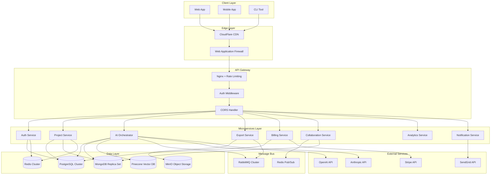
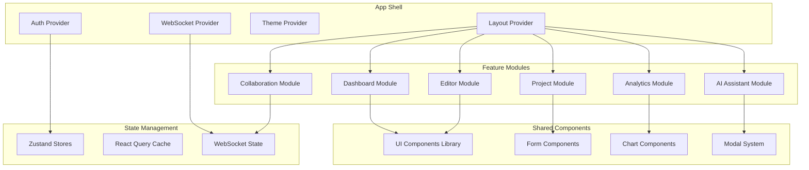
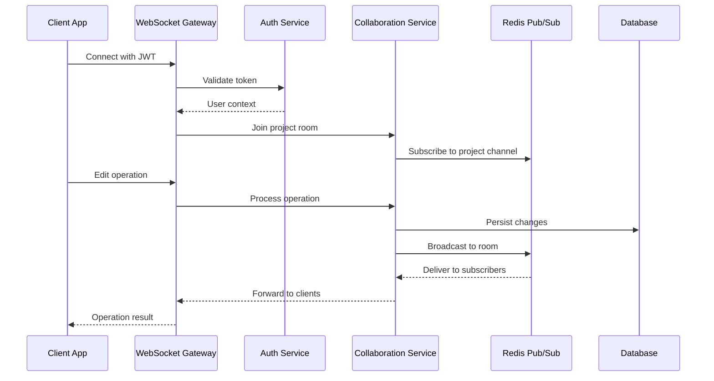

# WorldBest Platform Comprehensive Enhancement Design

## Overview

This enhancement design provides a strategic roadmap for transforming the WorldBest platform from its current development state into a production-ready, scalable commercial platform for writers. The design addresses performance optimization, feature completion, security hardening, operational excellence, and user experience improvements across all system components.

The enhancement strategy focuses on completing missing microservices, optimizing existing implementations, introducing advanced AI capabilities, implementing real-time collaboration features, and establishing enterprise-grade operational practices.

## Technology Stack Enhancement

### Current State Analysis

| Component | Current Status | Enhancement Priority |
|-----------|---------------|---------------------|
| Frontend (Next.js) | Partially implemented | High - Complete features |
| Authentication Service | Functional basic implementation | Medium - Security hardening |
| AI Orchestrator | Stub implementation | High - Core functionality |
| Project Service | Minimal implementation | High - Complete CRUD operations |
| Database Layer | Schema defined | Medium - Optimization |
| Infrastructure | Docker setup complete | Medium - Kubernetes optimization |

### Enhanced Technology Stack

| Layer | Technology | Enhancement Focus |
|-------|------------|------------------|
| **Frontend** | Next.js 14, React 18, TypeScript | Performance, real-time features, mobile responsiveness |
| **Backend Services** | Node.js, Fastify, Express | Microservices completion, performance optimization |
| **Databases** | PostgreSQL 16, MongoDB 7, Redis 7 | Query optimization, indexing strategies, caching |
| **AI/ML** | OpenAI GPT-4, Anthropic Claude, Pinecone | Advanced prompt engineering, embeddings optimization |
| **Infrastructure** | Kubernetes, Docker, Nginx | Production-grade deployment, auto-scaling |
| **Monitoring** | Prometheus, Grafana, ELK Stack | Comprehensive observability |

## Architecture Enhancement

### Enhanced System Architecture

### Microservices Enhancement Strategy

#### 1. Authentication Service Enhancement

**Current State**: Basic JWT authentication with rate limiting
**Enhanced Features**:
- Multi-factor authentication (TOTP, SMS, email)
- Social login integration (Google, GitHub, Discord)
- Role-based access control with fine-grained permissions
- Session management with refresh token rotation
- Audit logging for security events
- Password strength enforcement
- Account lockout protection
- SSO integration for enterprise customers

**Security Hardening**:
- Implement OAuth 2.0 + PKCE for mobile clients
- Add biometric authentication support
- Implement device fingerprinting
- Add suspicious activity detection
- Implement CSRF protection
- Add request signing for API security

#### 2. Project Service Enhancement

**Current State**: Minimal implementation with basic CRUD
**Enhanced Features**:
- Comprehensive project management with hierarchical structure
- Version control for all project artifacts
- Collaborative editing with conflict resolution
- Template system for common project types
- Advanced search across all project content
- Project analytics and progress tracking
- Backup and restore functionality
- Import/export from popular writing tools

**Data Model Enhancement**:
- Optimized database schema with proper indexing
- Document versioning with delta compression
- Real-time synchronization capabilities
- Advanced caching strategies
- Full-text search implementation
- Relationship mapping between entities

#### 3. AI Orchestrator Service Enhancement

**Current State**: Stub implementation with basic generation
**Enhanced Features**:
- Three specialized AI personas (Muse, Editor, Coach)
- Context-aware prompt engineering
- Multi-model routing and fallback strategies
- Token usage optimization and caching
- Batch processing for efficiency
- Custom model fine-tuning capabilities
- AI-powered content analysis and suggestions
- Intelligent content safety and moderation

**AI Persona Implementation**:

| Persona | Purpose | Model Strategy | Context Requirements |
|---------|---------|---------------|---------------------|
| **Muse** | Creative inspiration and brainstorming | GPT-4 Turbo, Claude-3 | Story bible, character profiles, plot outlines |
| **Editor** | Prose refinement and structural feedback | GPT-4, fine-tuned models | Draft text, style guides, target audience |
| **Coach** | Writing guidance and motivation | GPT-3.5 Turbo, specialized prompts | Progress data, goals, writing history |

#### 4. Collaboration Service (New)

**Purpose**: Real-time collaborative editing and communication
**Core Features**:
- Operational Transform for concurrent editing
- Real-time cursor tracking and user presence
- Comment system with threaded discussions
- Suggestion mode for editorial feedback
- Live chat integration
- Notification system for collaboration events
- Conflict resolution with manual merge capabilities
- Permission-based access control

**WebSocket Implementation**:
- Socket.IO for real-time communication
- Redis for horizontal scaling
- Message persistence for offline users
- Rate limiting for abuse prevention
- Authentication integration
- Room-based isolation for projects

#### 5. Export Service Enhancement

**Current State**: Not implemented
**Enhanced Features**:
- Multiple export formats (ePub, PDF, DOCX, HTML, JSON)
- Custom formatting and styling options
- Batch export capabilities
- Content redaction for sensitive material
- Metadata preservation
- Quality assurance checks
- Preview generation
- Distribution integration

**Export Pipeline**:
- Asynchronous job processing with RabbitMQ
- Template-based rendering system
- Image optimization and embedding
- Font handling and typography
- Accessibility compliance (WCAG 2.1)
- Progress tracking and notifications
- Error handling and retry mechanisms

#### 6. Billing Service Enhancement

**Current State**: Not implemented
**Enhanced Features**:
- Stripe integration with webhook handling
- Subscription management with tier upgrades
- Usage-based billing for AI features
- Team billing with seat management
- Invoice generation and payment tracking
- Dunning management for failed payments
- Proration handling for plan changes
- Enterprise billing with custom contracts

**Billing Tiers Enhancement**:

| Tier | Price | Enhanced Features | AI Limits | Storage |
|------|-------|------------------|-----------|---------|
| **Free** | $0 | 2 projects, basic editor | 10 generations/day | 100MB |
| **Solo** | $15/mo | 10 projects, full editor, mobile sync | 1000 generations/day | 5GB |
| **Pro** | $35/mo | Unlimited projects, voice features, analytics | 5000 generations/day | 50GB |
| **Team** | $149/mo | 5 seats, collaboration, admin tools | 25000 generations/month | 500GB |
| **Enterprise** | Custom | SSO, API access, white-label | Custom | Unlimited |

#### 7. Analytics Service (New)

**Purpose**: Comprehensive writing analytics and insights
**Core Features**:
- Writing progress tracking and goal setting
- Productivity analytics with time tracking
- Content analysis (readability, sentiment, style)
- AI usage analytics and optimization suggestions
- Team performance metrics for collaborative projects
- Custom reporting and dashboard creation
- Data export for external analysis
- Predictive analytics for writing patterns

**Metrics Tracking**:
- Word count progression over time
- Writing velocity and consistency
- Chapter/scene completion rates
- AI assistance effectiveness
- Collaboration patterns
- User engagement metrics
- Revenue and subscription analytics

#### 8. Notification Service (New)

**Purpose**: Multi-channel notification delivery
**Core Features**:
- Email notifications with templating
- In-app notifications with real-time delivery
- Push notifications for mobile apps
- SMS notifications for critical events
- Webhook delivery for integrations
- Notification preferences and unsubscribe management
- Delivery tracking and analytics
- Rate limiting and spam prevention

## Frontend Enhancement

### User Experience Improvements

#### Enhanced Dashboard
- Interactive writing analytics with charts and trends
- Quick access to recently edited content
- AI-powered writing suggestions and prompts
- Collaborative workspace indicators
- Progress tracking with visual goal representations
- Customizable widget layout
- Dark/light theme toggle with system preference detection

#### Advanced Text Editor
- Rich text editing with markdown support
- Real-time collaborative editing with conflict resolution
- AI-powered autocomplete and suggestions
- Grammar and style checking integration
- Version history with visual diff comparison
- Focus mode for distraction-free writing
- Word count goals with progress tracking
- Custom keyboard shortcuts

#### Mobile Responsiveness
- Progressive Web App (PWA) capabilities
- Offline editing with sync when online
- Touch-optimized interfaces
- Voice-to-text integration
- Mobile-specific navigation patterns
- Gesture support for common actions

#### Performance Optimization
- Code splitting and lazy loading
- Image optimization with WebP support
- Service worker for caching strategies
- Bundle size optimization
- Core Web Vitals optimization
- Server-side rendering for initial page loads

### Component Architecture Enhancement

## Data Layer Enhancement

### Database Optimization Strategy

#### PostgreSQL Enhancements
- Implement connection pooling with PgBouncer
- Create optimized indexes for common query patterns
- Implement read replicas for scaling read operations
- Set up automated backup and point-in-time recovery
- Configure query performance monitoring
- Implement partitioning for large tables
- Add database-level security policies

**Key Indexes Strategy**:
- User lookup by email and ID
- Project access by user and collaboration
- AI generation history with time-based partitioning
- Full-text search indexes for content
- Composite indexes for common filter combinations

#### MongoDB Enhancements
- Implement replica sets for high availability
- Configure sharding for horizontal scaling
- Optimize document structure for common access patterns
- Implement aggregation pipeline optimizations
- Set up change streams for real-time features
- Configure proper write concerns for consistency
- Implement TTL indexes for temporary data

**Document Structure Optimization**:
- Embed frequently accessed related data
- Use reference patterns for large collections
- Implement versioning with minimal overhead
- Optimize for real-time collaboration updates

#### Redis Enhancements
- Implement Redis Cluster for horizontal scaling
- Configure persistence with both RDB and AOF
- Optimize memory usage with appropriate data structures
- Implement keyspace notifications for real-time features
- Set up Redis Streams for event processing
- Configure connection pooling and retry logic

**Caching Strategy**:
- Session data with automatic expiration
- Frequently accessed project metadata
- AI generation results with intelligent invalidation
- User preferences and configuration
- Rate limiting counters with sliding windows

### Vector Database Integration

#### Pinecone Enhancement
- Optimize embedding strategies for different content types
- Implement hybrid search combining vector and keyword search
- Configure proper indexing for performance
- Implement batch upsert operations for efficiency
- Set up monitoring for query performance
- Implement cost optimization strategies

**Embedding Strategy**:
- Character profiles and personality vectors
- Scene descriptions and setting embeddings
- Plot point and story arc similarity
- Writing style and tone analysis
- Thematic content clustering

## Real-time Features Implementation

### WebSocket Architecture

### Collaborative Editing Implementation

#### Operational Transform Engine
- Implement Operational Transform (OT) for concurrent editing
- Handle character insertions, deletions, and formatting
- Resolve conflicts with deterministic transformation rules
- Maintain consistency across all connected clients
- Implement cursor position synchronization
- Handle user presence and awareness indicators

#### Conflict Resolution Strategy
- Automatic resolution for non-conflicting changes
- Manual resolution interface for complex conflicts
- Version history preservation during conflicts
- Rollback capabilities for error recovery
- Merge strategies based on operation timestamps
- User notification system for conflict events

## AI Integration Enhancement

### Advanced AI Orchestration

#### Multi-Model Strategy
- Implement intelligent model routing based on task type
- Configure fallback strategies for API failures
- Optimize token usage with caching and batch processing
- Implement cost tracking and budget controls
- Set up A/B testing for model performance
- Configure custom model endpoints for specialized tasks

#### Prompt Engineering Framework
- Template-based prompt construction
- Context injection with relevance scoring
- Dynamic prompt optimization based on results
- Version control for prompt templates
- A/B testing framework for prompt effectiveness
- User customization options for AI behavior

#### Context Management System
- Intelligent context selection based on relevance
- Context summarization for token efficiency
- Hierarchical context organization (project → chapter → scene)
- Real-time context updates during collaboration
- Context versioning for consistency
- Privacy controls for sensitive content

### AI Safety and Moderation

#### Content Safety Framework
- Multi-layered content filtering
- Sensitive content detection and flagging
- Customizable safety settings per user
- Audit logging for safety decisions
- Appeal process for false positives
- Integration with external moderation services

#### Bias Detection and Mitigation
- Bias detection in AI-generated content
- Diverse perspective suggestions
- Cultural sensitivity checks
- Inclusive language recommendations
- Representation analysis tools
- Community guidelines enforcement

## Security Enhancement

### Authentication and Authorization

#### Enhanced Security Model
- Implement Zero Trust architecture principles
- Multi-factor authentication with multiple options
- Device registration and trust management
- Behavioral analytics for anomaly detection
- API key management for third-party integrations
- Regular security audit logging

#### Data Protection Strategy
- End-to-end encryption for sensitive content
- Encryption at rest for all databases
- Secure key management with rotation
- GDPR compliance with data portability
- Right to be forgotten implementation
- Data retention policies with automatic cleanup

### API Security

#### Rate Limiting and Throttling
- Dynamic rate limiting based on user tier
- Distributed rate limiting across services
- Burst capacity handling
- Graceful degradation under high load
- DDoS protection with traffic shaping
- Bot detection and mitigation

#### Input Validation and Sanitization
- Comprehensive input validation at all endpoints
- SQL injection prevention with parameterized queries
- XSS protection with content sanitization
- File upload security with virus scanning
- Request size limits and timeout handling
- Schema validation for all API requests

## Performance Optimization

### Application Performance

#### Backend Optimization
- Implement connection pooling for all databases
- Configure caching strategies at multiple layers
- Optimize database queries with proper indexing
- Implement async processing for heavy operations
- Configure load balancing with health checks
- Set up auto-scaling based on metrics

#### Frontend Optimization
- Implement code splitting and lazy loading
- Optimize bundle sizes with tree shaking
- Configure service workers for caching
- Implement image optimization and WebP support
- Minimize Core Web Vitals metrics
- Optimize for mobile performance

### Database Performance

#### Query Optimization
- Analyze and optimize slow queries
- Implement proper indexing strategies
- Configure query caching where appropriate
- Optimize aggregation pipelines in MongoDB
- Implement read replicas for scaling
- Configure connection pooling for efficiency

#### Caching Strategy
- Multi-layer caching with Redis
- Application-level caching for computed results
- CDN caching for static assets
- Database query result caching
- Session and user data caching
- Intelligent cache invalidation

## Operational Excellence

### Monitoring and Observability

#### Comprehensive Monitoring Stack
- Prometheus for metrics collection
- Grafana for visualization and alerting
- ELK Stack for centralized logging
- Jaeger for distributed tracing
- OpenTelemetry for unified observability
- Custom dashboards for business metrics
- Real-time alerting with PagerDuty integration
- Performance profiling and APM
- Error tracking with Sentry integration

#### Key Metrics Tracking
- API response times and error rates
- Database query performance
- AI generation latency and costs
- User engagement and retention metrics
- System resource utilization
- Business KPIs and revenue metrics

### DevOps and Deployment

#### CI/CD Pipeline Enhancement
- GitHub Actions with advanced workflows
- Automated testing at multiple stages
- Security scanning with SAST/DAST tools
- Container image scanning for vulnerabilities
- Blue-green deployments for zero downtime
- Feature flags for controlled rollouts
- Automated rollback on failure detection

#### Infrastructure as Code
- Terraform for cloud resource management
- Kubernetes manifests with Helm charts
- Environment-specific configurations
- Automated backup and disaster recovery
- Cost optimization with resource tagging
- Multi-region deployment capabilities

#### Container Orchestration
- Kubernetes cluster optimization
- Auto-scaling based on custom metrics
- Resource quotas and limits
- Network policies for security
- Persistent volume management
- Service mesh with Istio
- Certificate management with cert-manager

### Quality Assurance

#### Testing Strategy Enhancement
- Unit testing with comprehensive coverage
- Integration testing for API endpoints
- End-to-end testing with Playwright
- Performance testing with k6
- Security testing with automated tools
- Accessibility testing compliance
- Load testing for scalability validation

#### Code Quality Assurance
- ESLint and Prettier for code formatting
- TypeScript strict mode enforcement
- SonarQube for code quality metrics
- Dependency vulnerability scanning
- Code review guidelines and automation
- Documentation as code practices

## User Experience Enhancement

### Interface Design Improvements

#### Dashboard Enhancement
- Personalized dashboard with drag-and-drop widgets
- Real-time progress tracking with animated charts
- AI-powered writing insights and recommendations
- Quick access to recent documents and collaborations
- Customizable themes and layout preferences
- Keyboard shortcuts for power users
- Accessibility improvements (WCAG 2.1 AA)

#### Writing Environment
- Distraction-free writing mode with focus tools
- Advanced formatting toolbar with custom styles
- Real-time word count and writing goals
- AI assistant panel with contextual suggestions
- Version history with visual diff comparison
- Comment system for editorial feedback
- Split-screen editing for reference materials

#### Mobile Experience
- Native mobile app development (React Native)
- Offline writing capabilities with sync
- Voice-to-text integration
- Touch-optimized editing interface
- Mobile-specific navigation patterns
- Push notifications for collaboration
- Gesture-based shortcuts

### Accessibility Improvements

#### Universal Design Principles
- Screen reader compatibility with ARIA labels
- Keyboard navigation for all features
- High contrast theme options
- Font size adjustment capabilities
- Voice control integration
- Cognitive accessibility features
- Multi-language support

#### Inclusive Features
- Dyslexia-friendly font options
- Reading comprehension aids
- Visual impairment accommodations
- Motor disability support
- Customizable interface elements
- Alternative input methods

## Advanced Features Implementation

### AI-Powered Content Analysis

#### Writing Analytics Engine
- Prose quality analysis with style suggestions
- Character development tracking across scenes
- Plot consistency verification
- Pacing analysis with recommendations
- Dialogue attribution and voice consistency
- Theme and motif identification
- Readability scoring and improvement suggestions

#### Semantic Content Understanding
- Entity recognition for characters, places, and objects
- Relationship mapping between story elements
- Timeline consistency checking
- World-building coherence analysis
- Cultural sensitivity analysis
- Genre convention adherence

### Advanced Collaboration Features

#### Team Management
- Role-based permissions with custom roles
- Project templates for different team types
- Workflow automation for editorial processes
- Review and approval cycles
- Task assignment and tracking
- Team analytics and productivity metrics

#### Communication Integration
- Integrated chat with project context
- Video conferencing integration
- Screen sharing for collaborative editing
- Annotation tools for feedback
- Notification preferences and filtering
- External tool integrations (Slack, Discord)

### Publishing and Distribution

#### Publishing Workflow
- Multi-format export with professional layouts
- Print-on-demand integration
- eBook distribution to major platforms
- Audiobook production workflow
- Rights management and licensing
- Royalty tracking and reporting

#### Marketing Tools
- Author platform integration
- Social media content generation
- Book trailer creation tools
- Reader engagement analytics
- Launch campaign automation
- Review and rating aggregation

## Implementation Roadmap

### Phase 1: Foundation Enhancement (Months 1-3)

#### Core Infrastructure
- Complete authentication service security hardening
- Implement project service with full CRUD operations
- Enhance database performance with optimized indexing
- Set up comprehensive monitoring and alerting
- Implement basic real-time collaboration
- Complete AI orchestrator with three personas

#### Frontend Improvements
- Enhance dashboard with interactive analytics
- Implement responsive design for mobile devices
- Add real-time updates with WebSocket integration
- Optimize performance with code splitting
- Implement accessibility improvements

### Phase 2: Advanced Features (Months 4-6)

#### AI Integration
- Implement advanced prompt engineering framework
- Add context-aware content generation
- Integrate vector search for semantic similarity
- Implement content safety and moderation
- Add usage analytics and optimization

#### Collaboration Enhancement
- Complete operational transform implementation
- Add advanced conflict resolution
- Implement team management features
- Add communication tools integration
- Implement granular permissions system

### Phase 3: Scale and Polish (Months 7-9)

#### Enterprise Features
- Implement SSO and enterprise authentication
- Add advanced analytics and reporting
- Implement white-label customization
- Add API access for integrations
- Implement advanced export and publishing tools

#### Performance and Reliability
- Implement auto-scaling infrastructure
- Add multi-region deployment
- Optimize for high availability
- Implement disaster recovery procedures
- Complete security audit and penetration testing

### Phase 4: Innovation and Growth (Months 10-12)

#### Advanced AI Features
- Implement custom model fine-tuning
- Add voice and audio processing
- Implement visual content generation
- Add multilingual support
- Implement predictive analytics

#### Market Expansion
- Launch mobile applications
- Implement marketplace for templates and tools
- Add community features and user-generated content
- Implement affiliate and referral programs
- Launch API ecosystem for third-party developers

## Success Metrics and KPIs

### Technical Metrics

| Metric Category | Current Target | Enhanced Target | Measurement Method |
|----------------|---------------|-----------------|--------------------|
| **API Response Time** | < 500ms | < 200ms | Prometheus monitoring |
| **Database Query Time** | < 100ms | < 50ms | Query performance logs |
| **AI Generation Latency** | < 30s | < 10s | Custom metrics tracking |
| **System Uptime** | 99% | 99.9% | Health check monitoring |
| **Error Rate** | < 5% | < 1% | Error tracking systems |

### Business Metrics

| Metric Category | Current Target | Enhanced Target | Measurement Method |
|----------------|---------------|-----------------|--------------------|
| **User Retention** | 60% (30-day) | 80% (30-day) | Analytics tracking |
| **Conversion Rate** | 2% | 5% | Billing system metrics |
| **Daily Active Users** | 1,000 | 10,000 | User activity tracking |
| **AI Usage Rate** | 30% | 70% | Feature usage analytics |
| **Customer Satisfaction** | 4.0/5 | 4.5/5 | User feedback surveys |

### Quality Metrics

| Metric Category | Current Target | Enhanced Target | Measurement Method |
|----------------|---------------|-----------------|--------------------|
| **Code Coverage** | 70% | 90% | Automated testing |
| **Security Score** | 8/10 | 9.5/10 | Security scanning tools |
| **Performance Score** | 80/100 | 95/100 | Lighthouse audits |
| **Accessibility Score** | 85/100 | 98/100 | WAVE and axe testing |
| **Bug Resolution Time** | 48 hours | 24 hours | Issue tracking |

## Risk Mitigation Strategy

### Technical Risks

#### High-Impact Risks
- **AI API Rate Limiting**: Implement multi-provider fallback and intelligent caching
- **Database Performance**: Regular performance monitoring and optimization
- **Security Vulnerabilities**: Continuous security scanning and regular audits
- **Scalability Bottlenecks**: Proactive capacity planning and auto-scaling

#### Medium-Impact Risks
- **Third-party Integration Failures**: Circuit breaker patterns and graceful degradation
- **Data Loss**: Comprehensive backup strategy with point-in-time recovery
- **Performance Degradation**: Performance budgets and continuous monitoring
- **Dependency Vulnerabilities**: Automated dependency scanning and updates

### Business Risks

#### Market Risks
- **Competition**: Focus on unique AI-powered features and user experience
- **Technology Changes**: Modular architecture for easy technology migration
- **Regulatory Changes**: Proactive compliance and legal review processes
- **Economic Downturns**: Flexible pricing and cost optimization strategies

#### Operational Risks
- **Key Personnel Dependencies**: Knowledge documentation and cross-training
- **Vendor Lock-in**: Multi-cloud strategy and open-source alternatives
- **Data Privacy Concerns**: Transparent privacy policies and user controls
- **Customer Churn**: Proactive customer success and retention programs

## Technology Innovation Opportunities

### Emerging AI Technologies

#### Large Language Model Advances
- Integration with GPT-5 and Claude-4 when available
- Fine-tuning on domain-specific writing datasets
- Multi-modal AI for image and audio integration
- Federated learning for privacy-preserving improvements

#### Voice and Audio Processing
- Real-time voice-to-text for hands-free writing
- AI-powered audiobook narration
- Voice cloning for character dialogue
- Podcast and audio content generation

### Extended Reality Integration

#### Virtual Reality Writing
- Immersive writing environments
- Virtual world-building tools
- Collaborative VR writing sessions
- Spatial story visualization

#### Augmented Reality Features
- AR visualization of story elements
- Interactive character and world modeling
- Real-world location integration for settings
- Mixed reality collaborative editing

### Blockchain and Web3 Integration

#### Digital Rights Management
- NFT-based ownership and licensing
- Smart contracts for royalty distribution
- Decentralized publishing platforms
- Creator economy tokenization

#### Community and Governance
- DAO-based platform governance
- Token-based creator rewards
- Decentralized content moderation
- Community-driven feature development

This comprehensive enhancement design provides a strategic roadmap for transforming WorldBest into a market-leading platform for writers, combining cutting-edge AI technology with robust infrastructure and exceptional user experience.