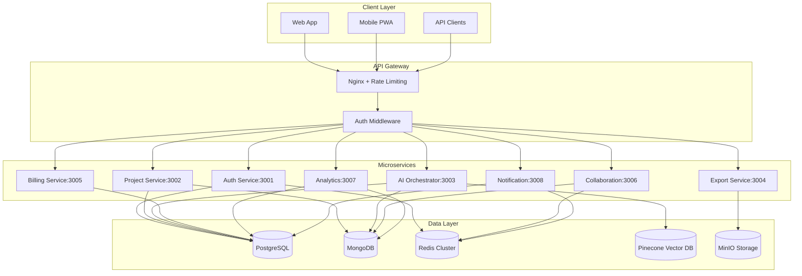

# WorldBest Platform Enhancement Implementation Plan

## Executive Summary

This document provides a comprehensive implementation plan for transforming the WorldBest platform from its current development state into a production-ready, scalable commercial platform for writers. The plan is based on the comprehensive enhancement design document and addresses all aspects of the platform including missing microservices, security hardening, performance optimization, and operational excellence.

## Current Implementation Status

### ✅ Completed Foundation
- **Authentication Service** - Functional with JWT-based auth, rate limiting, and basic security
- **Project Service** - Basic implementation with CRUD operations (needs completion)
- **AI Orchestrator** - Stub implementation with basic generation capabilities
- **Frontend Application** - Next.js web app with authentication, dashboard, and UI components
- **Database Schema** - Comprehensive Prisma schema with all entities and relationships
- **Infrastructure Setup** - Docker Compose, Kubernetes manifests, and deployment configurations
- **Shared Packages** - TypeScript types, UI components, and database utilities

### 🚀 Phase 1 Completed: Missing Services Scaffolding
✅ **Export Service** - Complete scaffolding with:
- Package.json with all necessary dependencies (Puppeteer, ePub generation, DOCX, PDF libraries)
- Dockerfile with optimized multi-stage build and Chromium setup
- TypeScript configuration
- Basic service structure with Express, security middleware, and health checks

✅ **Billing Service** - Complete scaffolding with:
- Package.json with Stripe integration, webhook handling, and cron jobs
- Dockerfile optimized for production deployment
- TypeScript configuration
- Service structure for subscription management and payment processing

✅ **Collaboration Service** - Complete scaffolding with:
- Package.json with Socket.IO, Operational Transform, and real-time features
- Dockerfile for WebSocket deployment
- TypeScript configuration
- Foundation for real-time collaborative editing

✅ **Analytics Service** - Complete scaffolding with:
- Package.json with data processing, charting, and analytics libraries
- Dockerfile for analytics workloads
- TypeScript configuration
- Structure for writing analytics and insights

✅ **Notification Service** - Complete scaffolding with:
- Package.json with multi-channel delivery (email, SMS, push notifications)
- Dockerfile for notification processing
- TypeScript configuration
- Foundation for comprehensive notification system

✅ **Docker Compose Updates** - All new services integrated into deployment configuration

## Implementation Roadmap

### Phase 2: Authentication Service Enhancement (High Priority)
**Timeline: 2-3 weeks**

#### Multi-Factor Authentication Implementation
- **TOTP Support**: Time-based one-time passwords with QR code generation
- **SMS Authentication**: Twilio integration for SMS-based 2FA
- **Email Verification**: Enhanced email-based authentication flows
- **Backup Codes**: Recovery codes for account access

#### Social Login Integration
- **OAuth 2.0 + PKCE**: Secure authorization code flow implementation
- **Google Integration**: Google OAuth for seamless login
- **GitHub Integration**: Developer-focused authentication
- **Discord Integration**: Community-oriented login option

#### Security Hardening
- **Role-Based Access Control (RBAC)**: Fine-grained permission system
- **Session Management**: Refresh token rotation and secure session handling
- **Device Fingerprinting**: Enhanced security through device identification
- **Audit Logging**: Comprehensive security event tracking
- **Suspicious Activity Detection**: Automated threat detection and response

### Phase 3: AI Orchestrator Enhancement (High Priority)
**Timeline: 3-4 weeks**

#### AI Persona Implementation
- **Muse Persona**: Creative inspiration and brainstorming assistant
  - Context-aware prompt engineering for creative tasks
  - Integration with story bible and character data
  - Advanced creative writing suggestions
  
- **Editor Persona**: Prose refinement and structural feedback
  - Grammar and style checking integration
  - Structural analysis and improvement suggestions
  - Consistency and continuity checking
  
- **Coach Persona**: Writing guidance and motivation
  - Progress tracking and goal setting
  - Personalized writing advice and encouragement
  - Productivity insights and recommendations

#### Advanced AI Features
- **Multi-Model Routing**: Intelligent selection between GPT-4, Claude, and specialized models
- **Fallback Strategies**: Robust error handling and alternative model usage
- **Token Optimization**: Advanced caching and batch processing for cost efficiency
- **Content Safety**: AI-powered moderation and bias detection
- **Custom Fine-Tuning**: User-specific model adaptation capabilities

### Phase 4: Real-Time Collaboration Implementation (High Priority)
**Timeline: 4-5 weeks**

#### Operational Transform Engine
- **Concurrent Editing**: Real-time collaborative text editing with conflict resolution
- **Document Synchronization**: Efficient delta-based synchronization
- **Version Control**: Comprehensive versioning with merge capabilities
- **Conflict Resolution**: Automated and manual conflict resolution strategies

#### WebSocket Architecture
- **Socket.IO Integration**: Scalable real-time communication
- **Room Management**: Project-based collaboration spaces
- **User Presence**: Real-time user awareness and cursor tracking
- **Message Persistence**: Offline message handling and delivery

#### Collaboration Features
- **Comment System**: Threaded discussions and feedback
- **Suggestion Mode**: Editorial feedback and approval workflows
- **Live Chat**: Integrated communication for collaborators
- **Permission Control**: Granular access control for collaborative features

### Phase 5: Export Service Implementation (Medium Priority)
**Timeline: 3-4 weeks**

#### Multi-Format Export
- **ePub Generation**: Professional ebook creation with metadata
- **PDF Export**: High-quality PDF generation with custom formatting
- **DOCX Support**: Microsoft Word compatible document export
- **HTML Export**: Web-ready content with styling
- **JSON Export**: Structured data export for integrations

#### Advanced Export Features
- **Template System**: Customizable export templates and styling
- **Batch Processing**: Asynchronous job processing with RabbitMQ
- **Quality Assurance**: Automated content validation and error checking
- **Preview Generation**: Real-time export previews
- **Distribution Integration**: Direct publishing to various platforms

### Phase 6: Billing Service Implementation (Medium Priority)
**Timeline: 3-4 weeks**

#### Stripe Integration
- **Payment Processing**: Secure payment handling with Stripe
- **Webhook Management**: Real-time payment event processing
- **Subscription Management**: Automated billing and renewals
- **Invoice Generation**: Professional invoicing and payment tracking

#### Advanced Billing Features
- **Usage-Based Billing**: AI token usage tracking and billing
- **Team Management**: Multi-seat subscriptions and team billing
- **Proration Handling**: Fair billing for plan changes and upgrades
- **Dunning Management**: Automated handling of failed payments
- **Enterprise Features**: Custom contracts and enterprise billing

### Phase 7: Analytics & Notification Services (Medium Priority)
**Timeline: 2-3 weeks each**

#### Analytics Service
- **Writing Analytics**: Progress tracking, word count analysis, and productivity metrics
- **AI Usage Analytics**: Token usage optimization and cost tracking
- **Content Analysis**: Readability, sentiment, and style analysis
- **Team Analytics**: Collaborative performance metrics
- **Predictive Analytics**: Writing pattern analysis and goal prediction

#### Notification Service
- **Multi-Channel Delivery**: Email, SMS, push notifications, and webhooks
- **Template Management**: Customizable notification templates
- **Preference Management**: User-controlled notification settings
- **Delivery Tracking**: Comprehensive delivery analytics and reporting
- **Rate Limiting**: Intelligent spam prevention and delivery optimization

### Phase 8: Frontend Enhancement (Medium Priority)
**Timeline: 4-5 weeks**

#### Dashboard Enhancements
- **Interactive Analytics**: Real-time charts and progress visualizations
- **AI-Powered Suggestions**: Contextual writing prompts and recommendations
- **Customizable Widgets**: Personalized dashboard layout and content
- **Mobile Responsiveness**: Optimized mobile and tablet experiences

#### Advanced Text Editor
- **Collaborative Editing**: Real-time multi-user editing capabilities
- **AI Autocomplete**: Intelligent text completion and suggestions
- **Version History**: Visual diff comparison and version management
- **Focus Mode**: Distraction-free writing environment
- **Markdown Support**: Rich text editing with markdown compatibility

#### Performance Optimization
- **Code Splitting**: Optimized bundle loading and lazy loading
- **Service Workers**: Offline functionality and caching strategies
- **Core Web Vitals**: Performance optimization for search and user experience
- **Progressive Web App**: Native app-like experience on mobile devices

### Phase 9: Database & Infrastructure Optimization (Low Priority)
**Timeline: 3-4 weeks**

#### Database Optimization
- **PostgreSQL Enhancement**: Connection pooling, indexing, and read replicas
- **MongoDB Optimization**: Replica sets, sharding, and query optimization
- **Redis Clustering**: Horizontal scaling and advanced caching strategies
- **Vector Database Integration**: Pinecone setup for semantic search and embeddings

#### Infrastructure Improvements
- **Kubernetes Optimization**: Auto-scaling, health checks, and production readiness
- **Monitoring Stack**: Prometheus, Grafana, ELK Stack, and distributed tracing
- **CI/CD Pipelines**: Automated testing, security scanning, and deployment
- **Security Hardening**: Comprehensive security measures and compliance

### Phase 10: Testing & Documentation (Ongoing)
**Timeline: Throughout all phases**

#### Comprehensive Testing
- **Unit Tests**: >80% code coverage across all services
- **Integration Tests**: Service-to-service communication testing
- **End-to-End Tests**: Complete user workflow validation
- **Load Testing**: Performance testing under realistic conditions
- **Security Testing**: Vulnerability assessment and penetration testing

#### Documentation & Developer Experience
- **API Documentation**: OpenAPI/Swagger specifications for all services
- **Developer Guides**: Setup, deployment, and contribution documentation
- **Architecture Documentation**: System design and decision documentation
- **User Documentation**: End-user guides and tutorials

## Technical Specifications

### Architecture Overview

### Service Port Allocation
- **Web Frontend**: 3000
- **Auth Service**: 3001
- **Project Service**: 3002
- **AI Orchestrator**: 3003
- **Export Service**: 3004
- **Billing Service**: 3005
- **Collaboration Service**: 3006
- **Analytics Service**: 3007
- **Notification Service**: 3008

### Technology Stack
- **Frontend**: Next.js 14, React 18, TypeScript, Tailwind CSS
- **Backend**: Node.js, Express/Fastify, TypeScript
- **Databases**: PostgreSQL 16, MongoDB 7, Redis 7, Pinecone
- **AI/ML**: OpenAI GPT-4, Anthropic Claude, Custom embeddings
- **Infrastructure**: Docker, Kubernetes, Nginx, Prometheus, Grafana
- **Storage**: MinIO for object storage, file system for temporary files
- **Message Queue**: RabbitMQ for async processing

## Risk Assessment & Mitigation

### High-Risk Areas
1. **Real-Time Collaboration Complexity**: Operational Transform implementation
   - *Mitigation*: Extensive testing, gradual rollout, fallback mechanisms

2. **AI Integration Costs**: Token usage and API rate limits
   - *Mitigation*: Intelligent caching, usage monitoring, cost controls

3. **Data Migration**: Existing data compatibility during enhancements
   - *Mitigation*: Careful migration planning, backup strategies, rollback procedures

### Medium-Risk Areas
1. **Performance at Scale**: Database and service performance under load
   - *Mitigation*: Load testing, performance monitoring, auto-scaling

2. **Security Vulnerabilities**: Complex authentication and authorization
   - *Mitigation*: Security audits, penetration testing, regular updates

## Success Metrics

### Technical Metrics
- **Performance**: <200ms API response times, >99.9% uptime
- **Security**: Zero critical vulnerabilities, comprehensive audit compliance
- **Scalability**: Support for 10,000+ concurrent users
- **Quality**: >80% test coverage, <1% error rate

### Business Metrics
- **User Experience**: >4.5/5 user satisfaction rating
- **Feature Adoption**: >60% adoption rate for new AI features
- **Platform Stability**: <2 hours downtime per month
- **Development Velocity**: 2-week sprint cycles with consistent delivery

## Conclusion

This comprehensive implementation plan provides a structured approach to transforming WorldBest into a production-ready platform. The phased approach ensures systematic delivery of high-value features while maintaining platform stability and security. With the foundation now in place through Phase 1 completion, the platform is ready for the next phases of enhancement that will deliver significant value to writers and establish WorldBest as a leading AI-powered writing platform.

The plan balances immediate high-impact improvements (authentication security, AI enhancement, real-time collaboration) with longer-term scalability and operational excellence. Each phase includes specific deliverables, timelines, and success criteria to ensure accountability and progress tracking.

*This plan represents the initial structure and can be adapted based on user feedback, market demands, and technical discoveries during implementation.*